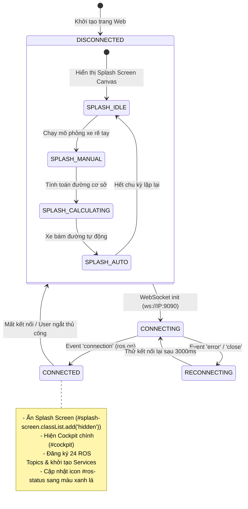
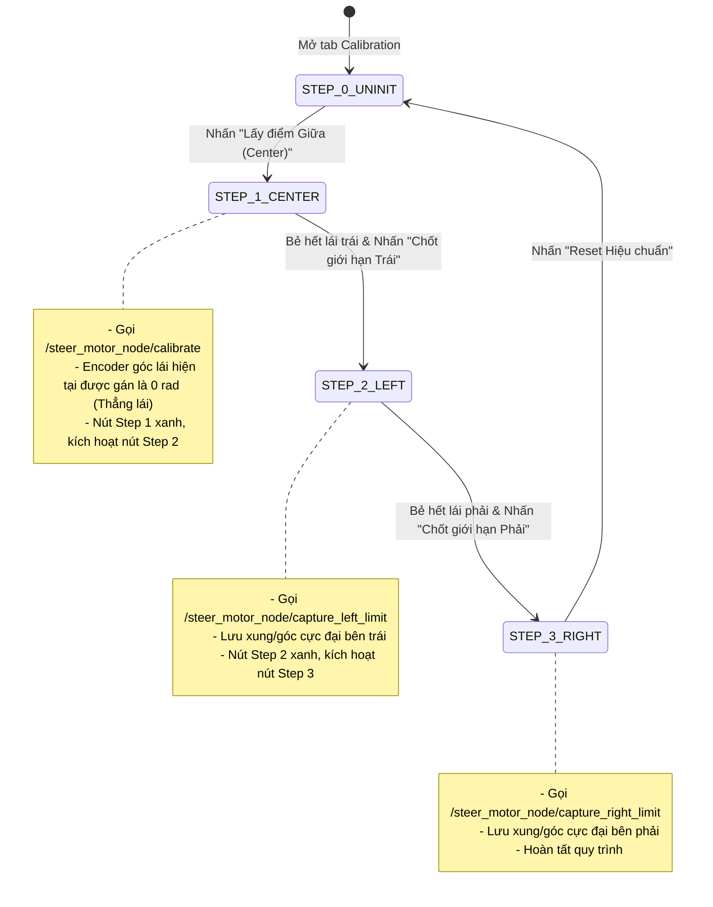

# TractorUI - Finite State Machines (FSM) Specification

Tài liệu này đặc tả toàn bộ các máy trạng thái hữu hạn (FSM) đang điều khiển luồng hoạt động của giao diện TractorUI (`index.html`). Mọi biểu đồ và quy tắc chuyển trạng thái đều được trích xuất trực tiếp từ logic code JavaScript thực tế.

---

## 1. Tổng quan các FSM trong Hệ thống

Hệ thống TractorUI bao gồm 5 máy trạng thái cốt lõi hoạt động song song hoặc lồng ghép:
1. **WebSocket Connection & Splash Screen FSM**: Quản lý vòng đời kết nối với ROSBridge và màn hình chờ mô phỏng Canvas 2D.
2. **Guidance Mode & Target Line Mux FSM**: Quản lý việc chuyển đổi giữa chế độ dẫn đường AB-Line và Lộ trình đường cày (Field Path).
3. **AB-Line Guidance Planner FSM**: Đồng bộ trạng thái ghi nhận đường thẳng tham chiếu với `/steer_planner_node/state_machine`.
4. **Field Path Follower FSM**: Điều khiển chu trình nạp lộ trình, bắt đầu, tạm dừng và khôi phục bám đường cày với `/path_follower_bridge/state`.
5. **Steering Motor Calibration Wizard FSM**: Quy trình từng bước hiệu chuẩn giới hạn cơ khí động cơ lái qua ROS services.
6. **Implement Depth Controller FSM**: Quản lý trạng thái nông/sâu, kích hoạt an toàn (Hold-to-Confirm) và cảnh báo chiếm quyền cabin.

---

## 2. WebSocket Connection & Splash FSM

Quản lý màn hình Splash lúc khởi động (`#splash-screen`) và trạng thái kết nối WebSocket tới rosbridge (`index.html` dòng 3244 - 3390, 4830 - 4890).



### Các chuyển trạng thái trong Code:
* **Khởi tạo kết nối**: Hàm `connectROS()` (`index.html#L3370`).
* **Sự kiện `ros.on('connection')`**: Đặt `isConnected = true`, đổi icon trạng thái, ẩn splash:
  ```javascript
  // index.html#L3374-3382
  statusDot.className = 'status-dot connected';
  statusText.textContent = 'Connected';
  document.getElementById('splash-screen').classList.add('hidden');
  initRosSubscribers();
  ```
* **Sự kiện `ros.on('error')` / `ros.on('close')`**: Đặt `isConnected = false`, icon chuyển đỏ, lên lịch retry sau 3000ms.

---

## 3. Guidance Mode & Target Line Mux FSM

Người vận hành chọn giữa **Ghi đường thẳng AB-Line** hoặc **Chạy lộ trình cày Field Path** (`index.html#L3800 - 3840`).

```mermaid
stateDiagram-v2
    [*] --> MODE_AB_LINE: Mặc định khởi động (currentControlMode = 'record')

    MODE_AB_LINE --> MODE_FIELD_PATH: Nhấn nút "Chạy lộ trình" (Khi Planner State == IDLE)
    MODE_FIELD_PATH --> MODE_AB_LINE: Nhấn nút "Ghi đường AB" (Khi Planner State == IDLE)

    state MODE_AB_LINE {
        [*] --> AB_IDLE
        note right of MODE_AB_LINE
            - Gửi /target_line_mux/select_mode = 1 (StdMsgsInt32)
            - Hiển thị nút Ghi đường (#record-line-btn)
            - Ẩn cụm nút Path Follower (#path-action-btns)
        end note
    }

    state MODE_FIELD_PATH {
        [*] --> PATH_IDLE
        note right of MODE_FIELD_PATH
            - Gửi /target_line_mux/select_mode = 2 (StdMsgsInt32)
            - Hiển thị cụm nút Path Follower (#path-action-btns)
            - Ẩn nút Ghi đường AB
        end note
    }

    note right of [*]
        Khóa an toàn: Chỉ cho phép chuyển Mode khi 
        plannerState === 1 (IDLE). Nếu đang RECORDING hoặc ACTIVE, 
        nút chuyển chế độ bị vô hiệu hóa hoặc chặn chuyển đổi.
    end note
```

---

## 4. AB-Line Guidance Planner FSM

Đồng bộ giữa UI và Node ROS 2 `/steer_planner_node` qua topic `/steer_planner_node/state_machine` (`index.html#L3770 - 3830`).

```mermaid
stateDiagram-v2
    [*] --> STATE_1_IDLE: Nhận state_machine = 1

    STATE_1_IDLE --> STATE_2_RECORDING: Nhấn nút "Bắt đầu ghi đường" / Dịch chuyển A-B
    STATE_2_RECORDING --> STATE_3_ACTIVE: Thu đủ 2 điểm A & B / Node xác nhận
    STATE_3_ACTIVE --> STATE_1_IDLE: Nhấn nút "Dừng / Hủy dẫn đường"

    state STATE_1_IDLE {
        description: Trạng thái chờ / Thủ công
        UI_Style: Nút Record Line màu xám/xanh dương "Ghi đường thẳng"
        Trail: Xóa vệt đường quá khứ
        TargetLine: Ẩn đường tham chiếu
    }

    state STATE_2_RECORDING {
        description: Đang ghi nhận đường cơ sở (A -> B)
        UI_Style: Nút nhấp nháy vàng "Đang ghi nhận..."
        TTS: Phát giọng nói "Bắt đầu ghi đường"
    }

    state STATE_3_ACTIVE {
        description: Tự động lái bám đường thẳng đang hoạt động
        UI_Style: Nút chuyển màu xanh lá rực rỡ "Tự động kích hoạt"
        TargetLine: Vẽ đường chuẩn nối dài vô hạn trên Leaflet
        TTS: Phát giọng nói "Bắt đầu tự động lái"
    }
```

* **Trạng thái 1 (IDLE)**: Xóa trail, tắt line tham chiếu (`clearTargetLine()`, `clearVehicleTrail()`).
* **Trạng thái 2 (RECORDING)**: Cập nhật giao diện ghi toạ độ A-B.
* **Trạng thái 3 (ACTIVE)**: Đường AB được vẽ nối dài vô hạn theo heading, phát âm thanh TTS tiếng Việt qua Web Speech API.

---

## 5. Field Path Follower FSM

Điều khiển việc bám theo đường quy hoạch diện tích cày mẫu lớn qua topic `/path_follower_bridge/state` (`index.html#L4160 - 4250`).

```mermaid
stateDiagram-v2
    [*] --> PATH_UNLOADED: Chưa có lộ trình (/field_path rỗng)

    PATH_UNLOADED --> PATH_LOADED: Nhận mảng toạ độ từ /field_path

    state PATH_LOADED {
        [*] --> BRIDGE_STATE_3_STOPPED: bridge_state = 3 (Đang dừng)
        
        BRIDGE_STATE_3_STOPPED --> BRIDGE_STATE_4_RUNNING: Nhấn "Bắt đầu" (Gửi start_stop: true hoặc resume)
        BRIDGE_STATE_4_RUNNING --> BRIDGE_STATE_3_STOPPED: Nhấn "Tạm dừng" (Gửi start_stop: false)

        BRIDGE_STATE_4_RUNNING --> BRIDGE_STATE_5_ERROR_FAR: Máy kéo cách quá xa điểm bắt đầu (> Max deviation)
        BRIDGE_STATE_5_ERROR_FAR --> BRIDGE_STATE_3_STOPPED: Đưa xe lại gần & nhấn Reset
    }

    state BRIDGE_STATE_3_STOPPED {
        Nút_UI: Nút màu xanh lá "Bắt đầu theo đường"
        Action: Gọi service /path_follower_bridge/resume hoặc start_stop=true
    }

    state BRIDGE_STATE_4_RUNNING {
        Nút_UI: Nút màu cam/đỏ "Tạm dừng"
        Action: Gọi service /path_follower_bridge/start_stop data=false
    }

    state BRIDGE_STATE_5_ERROR_FAR {
        Nút_UI: Báo lỗi đỏ
        Action: Cảnh báo Modal: "Vị trí máy kéo quá xa vạch xuất phát!"
    }
```

---

## 6. Steering Motor Calibration Wizard FSM

Quy trình hiệu chuẩn góc lái 4 bước được tích hợp trong Modal Cài đặt Kỹ thuật viên (`index.html#L4420 - 4530`).



---

## 7. Implement Depth Controller FSM (Kiến trúc Command ≠ Status)

Điều khiển cơ cấu nâng hạ nông sâu nông cụ ở đuôi máy kéo (`index.html#L4250 - 4550`). Toàn bộ trạng thái giao diện tuân thủ tuyệt đối nguyên lý **Command ≠ Status**: UI không bao giờ tự ý đổi trạng thái sang Active hoặc Disabled trước khi nhận telemetry phản hồi từ `/depth_link/status`. Khoảng thời gian bỏ qua phản hồi (Grace period) đã bị loại bỏ hoàn toàn.

```mermaid
stateDiagram-v2
    [*] --> DEPTH_DISABLED: Khởi động (depthEnabled = false)

    state DEPTH_DISABLED {
        UI: Nút Kích hoạt nền xám "KÍCH HOẠT NÔNG CỤ"
        Status: Nông cụ thả nổi / Không điều khiển tự động
    }

    state PENDING_ENGAGE {
        UI: Nút Kích hoạt nhấp nháy Pulse (.btn-pending)
        Status: Chờ xác nhận từ gateway ESP-NOW (/depth_link/status streaming: true)
    }

    state DEPTH_ACTIVE {
        UI: Nút Kích hoạt viền xanh ngọc / sáng "ĐANG ĐIỀU KHIỂN"
        
        [*] --> MODE_0_AUTO: Telemetry mode = 0 (Tự động theo độ sâu mm)
        MODE_0_AUTO --> MODE_1_MANUAL: Telemetry mode = 1 (Thủ công góc nâng độ)
        MODE_1_MANUAL --> MODE_2_HOME: Telemetry mode = 2 (Nhấc an toàn HOME)
        MODE_2_HOME --> MODE_0_AUTO: Telemetry mode = 0
    }

    state PENDING_DISENGAGE {
        UI: Thanh tiến trình Hold Fill 1000ms -> .btn-pending
        Status: Chờ xác nhận từ gateway (/depth_link/status streaming: false)
    }

    DEPTH_DISABLED --> PENDING_ENGAGE: Chạm 1 lần (<1000ms) nút KÍCH HOẠT
    PENDING_ENGAGE --> DEPTH_ACTIVE: Nhận /depth_link/status (streaming: true)
    PENDING_ENGAGE --> DEPTH_DISABLED: Timeout 3000ms không có phản hồi (Toast Error)

    DEPTH_ACTIVE --> PENDING_DISENGAGE: Nhấn giữ đủ 1000ms (Hold-to-Confirm)
    PENDING_DISENGAGE --> DEPTH_DISABLED: Nhận /depth_link/status (streaming: false)
    PENDING_DISENGAGE --> DEPTH_ACTIVE: Timeout 3000ms không có phản hồi (Toast Error)

    DEPTH_ACTIVE --> DEPTH_DISABLED: Telemetry timeout watchdog (>2500ms mất tín hiệu)
    
    DEPTH_ACTIVE --> DEPTH_PREEMPTED: Nhận /depth_link/status (preempted = true, streaming = false)
    DEPTH_PREEMPTED --> DEPTH_DISABLED: Cảnh báo Toast + Rung xúc giác haptic
```

---

## 8. Kiến trúc "Command ≠ Status" & Cơ chế đồng bộ chống mất đồng bộ (Desync)

### 8.1. Nguyên lý HMI Công nghiệp: "Command ≠ Status"
Trong các hệ thống điều khiển tự động cơ điện tử (nông nghiệp, công nghiệp, xe tự hành), **Lệnh gửi đi (Command)** hoàn toàn khác với **Trạng thái thực tế của máy (Status)**:
* **Giao diện KHÔNG BAO GIỜ lạc quan (No Optimistic UI)**: Khi người vận hành bấm nút "Bật", UI không được lập tức đổi nút sang màu xanh "Đang chạy". Nếu chấp hành viên bị kẹt van thủy lực, đứt cáp truyền thông, hoặc bị ngắt an toàn, việc UI hiển thị màu xanh sẽ gây nguy cơ tai nạn nghiêm trọng (người vận hành tưởng máy đã hạ cày hoặc dừng xe trong khi thực tế không phải).
* **Vòng đời 3 giai đoạn của mọi thao tác nút bấm**:
  1. **User Action / Request**: Người dùng bấm hoặc giữ nút. UI kích hoạt hiệu ứng tạm thời (Pending Pulse `.btn-pending`, Progress Bar) và gửi thông điệp ROS Service hoặc Topic.
  2. **Confirmation**: UI chỉ chuyển đổi trạng thái hiển thị chính thức khi nhận được tin nhắn trạng thái xác nhận từ ROS Service (`res.success == true`) hoặc Telemetry topic phản hồi (`/depth_link/status`, `/path_follower_bridge/state`, `/steer_planner_node/state_machine`). Khi nhận được, trạng thái Pending được gỡ bỏ.
  3. **Rejection / Timeout Rollback**: Nếu Service trả về thất bại (`res.success == false`), hoặc kết nối ROS bị mất, hoặc quá thời gian Timeout (3-5s) mà không có telemetry xác nhận: UI tự động hủy trạng thái Pending, hoàn nguyên trạng thái hiển thị theo phần cứng thực tế và bật Toast thông báo lỗi / cảnh báo cho người vận hành.

### 8.2. Bảng phân tích các nguyên nhân mất đồng bộ (Desync) & Giải pháp

| Kịch bản mất đồng bộ (Desync Scenario) | Nguyên nhân kỹ thuật | Hậu quả nếu dùng UI lạc quan | Cơ chế đồng bộ đã hiện thực trong TractorUI |
| :--- | :--- | :--- | :--- |
| **1. Rớt gói tin không dây ESP-NOW / WiFi** | Môi trường đồng ruộng nhiễu sóng hoặc vật cản làm rơi bản tin `DepthUiCommand` hoặc ROSBridge WebSocket | UI báo "Đã kích hoạt" nhưng cày vẫn chưa hạ hoặc ngược lại | - Nút hiển thị `.btn-pending` với timeout 3s.<br>- Không đổi cờ `depthEnabled` tại chỗ.<br>- Nếu sau 3s không có gói `/depth_link/status` xác nhận `streaming: true`, UI tự revert và hiển thị Toast "Hard confirmation timed out". |
| **2. Cần gạt cơ Cabin chiếm quyền (Preemption)** | Tài xế gạt cần nâng hạ cơ khí trong cabin khi hệ thống tự động đang chạy | UI vẫn nghĩ đang Auto, tiếp tục gửi target đè lên tay lái | - ESP32 Gateway phát hiện áp suất/công tắc cơ, lập tức nhả van và gửi `preempted: true, streaming: false`.<br>- UI nhận telemetry lập tức ngắt `depthEnabled = false`, rung haptic và hiện Toast cảnh báo nổi bật. |
| **3. Node ROS từ chối lệnh (Interlock / Validation Rejection)** | Người dùng bấm Bắt đầu bám đường khi xe ở quá xa lộ trình (> Max Deviation) hoặc chưa nạp file Path | UI đổi nút sang "Tạm dừng" trong khi xe vẫn đứng yên | - `callService` và `startPathFollowing` kiểm tra `res.success`. Nếu `false`, UI giữ nguyên trạng thái cũ, gỡ pending và hiển thị Toast lý do từ chối từ node backend. |
| **4. Topic Telemetry bị treo hoặc Node chết (Stale Telemetry)** | Node driver gặp sự cố, cáp USB UART bị lỏng, ESP32 gateway mất nguồn | UI hiển thị thông số cũ đóng băng (Freeze) | - Watchdog 1 Hz giám sát `lastDepthStatusAt` (> 2500ms) và `/espnow_link/stats` (> 3000ms).<br>- Nếu quá hạn, UI chuyển chấm link sang nhấp nháy đỏ, đưa các giá trị độ sâu về `--`, tự động ngắt trạng thái điều khiển trên UI và thông báo. |
| **5. Chuyển đổi chế độ dẫn đường khi đang bám luống** | Người dùng bấm chuyển từ Path Mode sang AB-Line khi xe đang chạy tự động | Nhảy đột ngột tín hiệu điều khiển lái (`/target_line_mux`) gây tai nạn giật lái | - Khóa liên động phần mềm: `setControlMode` kiểm tra `plannerState === 1` và `pathFollowerState !== 4`. Nếu không thỏa mãn, chặn chuyển đổi và bật Toast cảnh báo yêu cầu dừng xe trước. |
